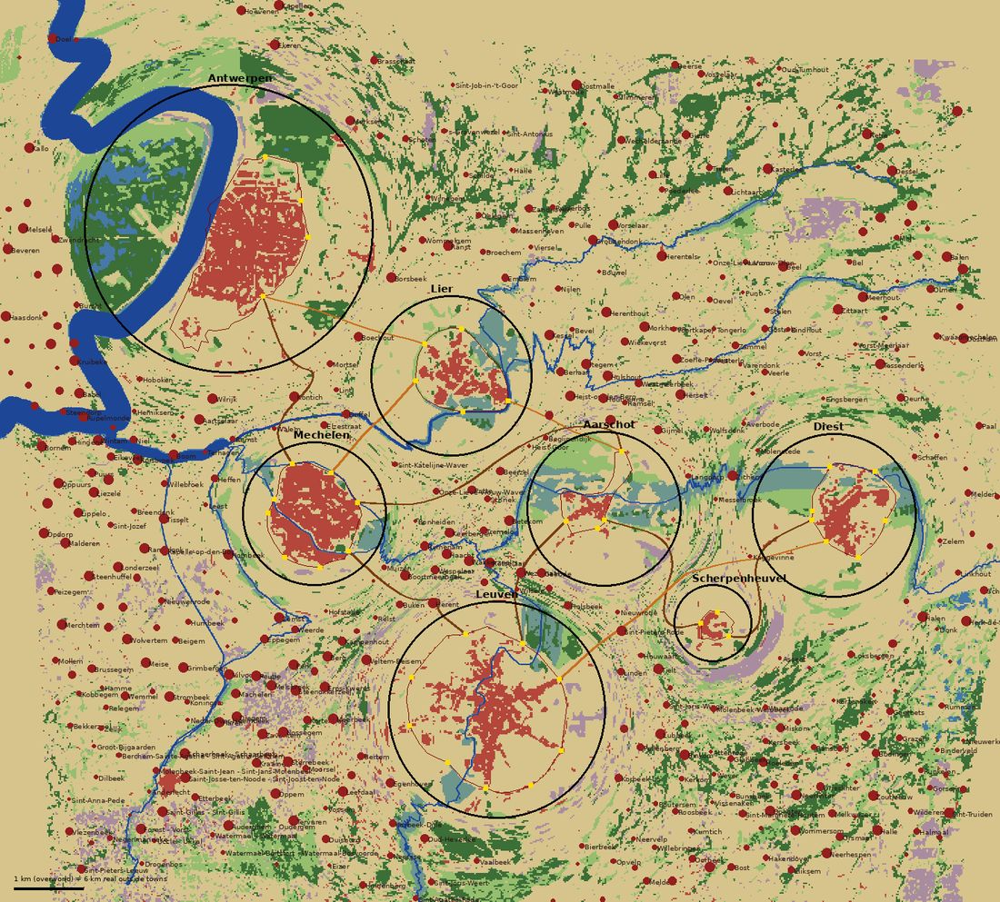

# Brabant c. 1650: the compressed overworld

The overworld holds seven towns of the Duchy of Brabant (Spanish Netherlands) as they stood around **1650**: Diest, Scherpenheuvel, Aarschot, Leuven, Mechelen, Lier and Antwerp. Each town is at true 1:1 scale. The countryside between them is compressed six-fold, so dragon flights stay short.

Data lives in `public/world/regions/`. The pipeline is in `tools/regions/`. It generalises the Diest 1560 method (`docs/history/diest-1560.md`).



## Sources

| Source | Date | Used for |
|---|---|---|
| OpenStreetMap (ODbL), Flanders extract from download.openstreetmap.fr | today | Building footprints, streets, waterways, river centrelines, main roads, village names |
| **Ferraris map**, via Digitaal Vlaanderen `geo.api.vlaanderen.be/HISTCART`, layer `ferraris` | 1771–1778 | Town walls, gates and gate names; which plots were built up; land cover; whether a village existed |
| Villaret map, same service, layer `Villaret` | 1745–1748 | Gate names (Mechelen) |

**Why the Ferraris map for 1650?** None of these towns changed its enceinte between 1650 and the 1770s:
- Antwerp's Spanish walls (1542–c.1567) and the citadel (1567–71) are unchanged.
- Leuven's second wall dates from 1357–63.
- Mechelen and Lier still had their medieval rings with a few later bastions.
- Scherpenheuvel's seven-sided enceinte dates from 1603–09.

Ferraris is the oldest map that is georeferenced and covers all of them at large scale. Its town plans line up with modern OSM to within about 10–20 m.

Ferraris also covers Brussels: the HISTCART service returns the walled city with its 17th-century bastions. Brussels can therefore be added the same way as these towns.

## Pipeline (`tools/regions/`)

| Step | Script | Output |
|---|---|---|
| Config | `towns.json`: centres, bboxes, K, ref, links between towns, region bbox | |
| OSM | `extract_pbf.py <flanders.osm.pbf>`. Overpass mirrors timed out from this machine. `fetch_town.py` and `fetch_region.py --overpass` still work as an Overpass fallback. | `$REGIONS_CACHE/<town>/osm/*.json`, `region/osm/{rivers,roads,places}.json` |
| Maps | `fetch_town.py --maps-only all`: Ferraris at 1.4 m/px and Villaret at 2.8 m/px per town bbox. `fetch_region.py`: Ferraris at 5 m/px over the region, as 49 tiles of 10 km. | `$REGIONS_CACHE/<town>/maps/`, `region/ferraris/` |
| OSM → local world | `node build_town.mjs <raw> <out> <lat> <lon> <name>`: a parameterised copy of `tools/osm/build-world.mjs` that also carries start dates and ids for dating | `build/<town>_osm.json` |
| Wall traces | `walls/<town>.json`, traced by hand with `view.py` (Ferraris crop with a labelled metre grid). Checked with `overlay.py`. | |
| Historicise | `historicize_town.py <town>`, using `ferraris_classes.py`, `landmarks.json` and `warp.py` | `public/world/regions/<town>.json` |
| Overworld | `build_overworld.py` | `overworld.json`, `landcover.png`, preview |

Regenerate everything:

```bash
cd tools/regions
python3 fetch_town.py --maps-only all && python3 fetch_region.py
python3 extract_pbf.py /path/flanders-latest.osm.pbf
for t in diest scherpenheuvel aarschot leuven mechelen lier antwerpen; do
  node build_town.mjs $REGIONS_CACHE/$t/osm $REGIONS_CACHE/build/${t}_osm.json <lat> <lon> <Name>   # values from towns.json
  python3 historicize_town.py $t
done
python3 build_overworld.py
```

`$REGIONS_CACHE` defaults to the session scratchpad; see `common.py`.

### Historicising a town (`historicize_town.py`)

The method is the Diest 1560 method, with the following changes.

**Land-cover classifier** (`ferraris_classes.py`):
- **Meadow and wood thresholds are relative to each sheet's median colour.** The Ferraris sheets were washed by different hands. The Diest-tuned absolute rule found almost no meadow on the Mechelen, Leuven and Antwerp sheets.
- **Houses are detected from the saturated red at full 1.4 m resolution.** The Leuven sheet draws houses as thin red frontage strips around garden blocks. Averaged to 4 m cells, they fell below the threshold and were rejected as "slope hatching".
- **Heath is detected by texture.** Ferraris washes heath pale mauve and draws no parcel lines on it, so it shows as a smooth, low-(G−B) area. Only patches over 30 ha count, which picks up the Kempen heaths.

**Buildings:**
- Kept on Ferraris built-up land, as for Diest.
- Landmarks that existed by 1650 are always kept and tagged with `lm` (church, belfry, townhall, clothhall, beguinage, castle, abbey, hall, gate, tower, house), a period name `n` and `hist: 1`. The list is in `landmarks.json`.
- Dropped, even on old plots:
  - buildings named in `landmarks.json` "drop" or the common drop list;
  - churches and civic buildings with an OSM start date after 1650;
  - every OSM building inside Antwerp's citadel (razed in the 19th century; its barracks are regenerated from Ferraris).
- Heights are capped: Antwerp 14 m, Leuven and Mechelen 12.5 m, other towns 11.5 m, countryside 7 m.

**Gap filling:** period row-house blocks in town and farmsteads outside, generated where Ferraris shows houses that no surviving footprint covers. Generated ids are `-(townIndex+1)·10⁶ − n`, unique across towns.

**Roads.** Dropped:
- railways, motorways, footways and roundabouts;
- the boulevards on the ramparts, identified by name (`vest`, `lei`, `kaai`, `singel`, `ring`, …) when they run along the trace;
- unnamed main roads that run along the wall line;
- minor streets inside the walls with no kept building nearby (19th–20th-century streets laid across the gardens and fields inside Leuven's and Antwerp's walls).

Streets inside the walls are cobbled (`c: 1`).

**Water:**
- Canals dug after 1650 are dropped: Leuven–Dijle 1750, Netekanaal, Albertkanaal.
- Moats follow the wall where the trace says so (`walls/<town>.json` "moat": ring-vertex ranges).
- Antwerp gets the 17th-century Scheldt strip in front of today's quays as a water area.

**Clipping:** everything is clipped to the town radius and shifted into overworld metres.

## Town files (`public/world/regions/<town>.json`)

The schema is exactly `WorldData` (`src/world/types.ts`, same as `public/world/diest_1560.json`), with `year: 1650` and `walls`. All coordinates are **overworld metres**: town-local metres plus the town's overworld centre. `origin` is the town's real centre.

Extra fields the game may ignore:
- `overworld: {id, centre, radius, K}`
- `walls.forts` (Antwerp citadel)
- `walls.gateSources` (where each gate name comes from)
- `buildings[].lm` (landmark kind)

| Town | OSM buildings | kept | landmarks | + town blocks | + farmsteads | out | overworld centre | radius (m) | size |
|---|---|---|---|---|---|---|---|---|---|
| Diest | 4757 | 1343 | 13 | 114 | 30 | 1499 | (7310, 237) | 1184 | 273 KB |
| Scherpenheuvel | 2180 | 384 | 1 | 8 | 14 | 412 | (5559, 1798) | 561 | 70 KB |
| Aarschot | 5094 | 603 | 6 | 48 | 24 | 687 | (3991, 143) | 1118 | 159 KB |
| Leuven | 30249 | 2392 | 24 | 273 | 66 | 2762 | (2444, 3043) | 1568 | 557 KB |
| Mechelen | 20742 | 4031 | 14 | 155 | 83 | 4298 | (−185, 213) | 1042 | 616 KB |
| Lier | 11987 | 1876 | 12 | 91 | 42 | 2023 | (1791, −1777) | 1162 | 341 KB |
| Antwerpen | 37818 | 6413 | 18 | 243 | 136 | 6865 | (−1420, −3896) | 2085 | 1212 KB |

The "kept" column already includes the landmarks.

### Walls and gates per town (traced vs inferred)

All rings are traced by hand from Ferraris and checked by overlay, to about ±20 m. On the land side the ring follows the main rampart line. Individual bastions are not traced, except Antwerp's citadel.

- **Antwerpen.**
  - Ring: the Spanish walls on the land side, the Scheldt front on the west, and the citadel pentagon in the south (also in `walls.forts`).
  - Gates from Ferraris labels: Slijkpoort ("Slyk Porte"), Rodepoort ("Porte Rouge"), Kipdorppoort, Sint-Jorispoort ("Porte de St George").
  - Not added: the Rubens Waterpoort (1624). It stood on the Scheldt front at the Vlasmarkt and has since been moved to the Gillisplaats, so its OSM position is wrong. Ferraris labels the riverside "Porte de Fer" but its exact position is unclear. The Begijnhof is a POI only.
- **Leuven.**
  - Ring: the second wall (1357–63), with a moat on the Dijle side (Kapucijnen to Tervuursepoort).
  - Gates from Ferraris: Mechelsepoort, Aarschotsepoort (label "Pte d'Aerschot ou …", second name illegible), Diestsepoort, Tiensepoort ("Tirlemont"), Parkpoort, Naamsepoort ("de Namur ou Heverlé"), Tervuursepoort ("Vieille Pte de Bruxelles ou du Château"), Brusselsepoort ("de Bruxelles ou des Vignes").
  - **Inferred**: Kapucijnenpoort (unlabelled gate at the Kapucijnenvoer).
  - The Lakenhalle (Universiteitshal) is identified by OSM way id 27289013 (Naamsestraat 22).
- **Mechelen.**
  - Ring: the outer medieval wall with moat.
  - Gate names are Dutch renderings of the Villaret labels: Antwerpsepoort, Koepoort ("de Vaches"), Diestsepoort, Leuvensepoort, Oude Brusselpoort ("Vieille Porte de Bruxelles"), Brusselpoort (still standing), Gentsepoort, Waterpoort.
- **Lier.**
  - Ring: the medieval ring with moat (on the east it is the Nete).
  - Gates from Ferraris: Antwerpsepoort, Mechelsepoort, Leuvensepoort.
  - **Inferred**: Lisperpoort (labelled "Porte de Bois-le-Duc", the road north via Lisp) and Sluispoort (labelled "Porte et Écluse du …", where the Nete leaves the town).
- **Aarschot.**
  - Ring: the walled town south of the Demer plus the moated causeway suburb to the Mechelen gate. No wet moat is traced.
  - Gates from Ferraris: Mechelsepoort, Waterpoort ("Porte de l'Eau"), Tiensepoort ("Tirlemont"), Leuvensepoort.
- **Scherpenheuvel.**
  - Ring: Cobergher's seven-sided enceinte with moat around the basilica.
  - Gates from Ferraris: Zichemsepoort, Leuvensepoort, Diestsepoort.
  - The basilica (consecrated 1627) and the star-shaped town are kept. This differs from the 1560 Diest world, which removes them.
- **Diest.** The 1560 trace is unchanged (`tools/history/walls_1560.json`). The wall did not change by 1650.

## Compression and warp

The overworld is built as follows (`warp.py`, `overworld.json` → `warp`):

- **Real frame:** the same equirectangular projection as build-world.mjs, around ref = Mechelen (51.0280 N, 4.4780 E). x is east and z is south, in metres. The overworld uses the same origin.
- **Town radius:** R_i = maximum distance of the wall ring (forts included) from the town centre + 250 m.
- **Layout:**
  - Targets: t_i = c_i_real / K, with **K = 6**.
  - Positions p_i start at t_i. They are relaxed by alternating two steps: pair constraint projection (|p_i − p_j| ≥ R_i + R_j + 600) and a spring back to t_i with decreasing strength. The last iterations use projection only.
  - Final shifts from the target: Mechelen 297 m, Leuven 335 m, Antwerp 606 m, Aarschot 693 m, Lier 725 m, Diest 835 m, Scherpenheuvel 963 m.
  - Five pairs end up exactly at the minimum separation: Diest–Scherpenheuvel, Scherpenheuvel–Aarschot, Aarschot–Leuven, Mechelen–Lier and Lier–Antwerp.
- **Overworld → real**, for overworld point p:
  - Inside town i (|p − p_i| ≤ R_i): q = c_i + (p − p_i), the exact 1:1 town.
  - Elsewhere: q = K·p + D(p), where
    - D(p) = Σ w_i d_i / Σ w_i
    - d_i = (c_i − K·p_i) − u_i·R_i·(K − 1)
    - u_i = (p − p_i)/|p − p_i|
    - w_i = 1 / max(|p − p_i| − R_i, 1 m)²
  - The term (c_i − K·p_i) is the requested "IDW blend of each town's (real centre − overworld centre·K) offset".
  - The extra radial term −u_i·R_i·(K − 1) makes the map **continuous at every town edge**. Near town i, q → c_i + u_i·(R_i + (s_i − R_i)·K): the land just outside a town's radius is the real land just outside its real radius, and the real distance then grows K times faster. Without this term, a real annulus from R_i to K·R_i around every town (up to 12 km at Antwerp) would be skipped.
  - Real metres → lat/lon: lat = ref.lat − z/110574, lon = ref.lon + x/(cos(ref.lat)·111320).
- **Real → overworld** (rivers, roads, villages): exact inside the real town circles. Elsewhere, Newton iteration on the forward map with a numerical Jacobian. Round-trip error is below 1e-9 m for 99.7 % of random test points. The exceptions all lie in or next to the fold north of Scherpenheuvel (see below), where a real point has two overworld images and Newton may return the other one.
- **Overworld size:** 14.42 × 13.02 km. Bounds are [−4720, −7200, 9700, 5820], i.e. the town circles plus a 1.2 km margin (≈ 7 km of real countryside).

## Overworld data (`public/world/regions/overworld.json`)

- **`towns`**: id, name, overworld `centre` [x, z], `radius`, `realLat`/`realLon`, `realCentre` (metres around ref), `file`, and `gates` {name: [x, z]} in overworld metres.
- **`landcover`** → `landcover.png`: an 8-bit palette PNG at 20 m per pixel, 721 × 651 px. Its origin is `bounds[0..1]`; pixel (i, j) covers x = x0 + 20i … +20 and z = z0 + 20j … +20.

  | Index | Class | RGB |
  |---|---|---|
  | 0 | field | 214,196,140 |
  | 1 | meadow | 150,190,110 |
  | 2 | wood | 60,110,55 |
  | 3 | heath | 170,140,160 |
  | 4 | water | 70,120,170 |
  | 5 | marsh | 110,150,140 |
  | 6 | built (villages) | 180,70,60 |

  - Each pixel is warped to a real point and takes the dominant Ferraris class of a K × 20 m window (120 m) there.
  - Inside town radii the mapping is 1:1 with a 20 m window. The town files are authoritative there.
  - Marsh is meadow within 300 m of a main river: the wet "broeken" of the Demer, Dijle, Nete and Scheldt valleys.
  - Rivers are painted on top at their real width.
  - Areas the service does not cover are field.
- **`rivers`** (20 polylines): Schelde 350 m, Rupel 150, Nete 40, Grote/Kleine Nete 16, Dijle 22, Demer 20, Zenne 14, and the Willebroekse vaart 20 (Brussels–Willebroek canal, opened 1561; today's Zeekanaal follows its line). Widths are real-scale.
  - Source: OSM river centrelines, merged per river, simplified at 8 m, densified every 150 m and warped.
  - The Durme, Leie and Dender lie outside the current region.
  - Later canals and the Leuven "Dijlearmen" are left out.
- **`roads`** (10): links listed in `towns.json`, gate to gate.
  - The gate is the one named after the other town if there is one, else the best-aligned one, else an override in `links`.
  - Route: shortest path over today's trunk, primary and secondary roads between the gates, warped. Most of these follow 17th–18th-century routes.
  - Warped modern roads twist at 1:6, so each route is generalised: Douglas–Peucker at 8 % of its length, then Chaikin smoothing (`src: "osm-generalised"`).
  - If the route still loops, backtracks or passes within 150 m of another town's circle, a straight-ish chaussee with a slight bend between the gates is used instead (`src: "chaussee"`).
  - Result: 6 generalised OSM routes and 4 chaussees. `realLengthKm` gives the real journey length.
- **`villages`** (426): OSM `place=village|hamlet|town` (towns become `kind: "town"`, e.g. Herentals, Vilvoorde, Zichem).
  - A place is kept only if Ferraris shows at least 600 m² of built-up land within 250 m.
  - `size` is the estimated number of houses: built area / 150 m², clamped to 3–400.
  - Places are warped, those inside a town radius + 150 m are removed, and places closer than 250 m in the overworld are deduplicated (larger kind and size first).
- **`bounds`, `K`, `ref`, `warp`** (formula plus per-town real/ow/R), **`attribution`**.

## Known deviations and issues

- **The warp folds** in about 0.13 % of the overworld, in a patch just north of Scherpenheuvel. Scherpenheuvel is small (R = 561 m) and was pushed almost 1 km south of its compressed target to clear Diest and Aarschot. Around it the land cover shows a visible swirl, and real points there have two overworld images. A larger margin around small towns, or a smoother weight (higher power), would reduce this.
- **Rivers follow their modern courses.** This affects:
  - the Demer at Aarschot and Diest;
  - the Scheldt quays at Antwerp (the 1650 bank is approximated by a 230 m water strip along the traced Scheldt front);
  - the Dijle arms in Leuven, which come from OSM.
- **Modern main roads outside the walls are kept where they are primary/secondary/tertiary.** Examples: the 19th-century dock roads north of Antwerp and the roads across the Antwerp left-bank polders. In-town streets are well filtered; the country-road filter is the Diest one.
- **Building shapes** inside the walls are today's footprints wherever a building stands on a 1777 built-up plot. Some later rebuilds keep their later shape (named ones lose their modern name).
- **Landmark lists are curated.** Anything not listed is dated only by OSM `start_date`, which is often missing. The Jesuit churches of Leuven (Sint-Michiel, 1650–66) and Mechelen (Sint-Pieter-en-Paul, 1670s) and the Hanswijk basilica (1663–78) are dropped. Their predecessors on those plots are not modelled.
- **Ferraris dates from the 1770s.** A few 1650–1770 changes in land use and village size are not corrected for.
- **The moat line** is a fixed offset outside the trace (18 m wide; Antwerp 34 m). Antwerp's real moat was wider and lay further out beyond the bastions.
- **Brussels** is covered by Ferraris but is not a town yet. In the overworld it shows only as built-up land cover beside its suburbs (Schaerbeek, Molenbeek, …, which appear as villages).
- **Phase B** (Ghent, Bruges, Dendermonde, Aalst, Oudenaarde, Kortrijk, Ypres) was not done. Adding a town takes four steps:
  1. a `towns.json` entry (and its `links`);
  2. a wall trace in `walls/<town>.json`;
  3. a `landmarks.json` entry;
  4. a larger `region` bbox, followed by `fetch_region.py` and `extract_pbf.py`.

## Attribution

Map data © OpenStreetMap contributors (ODbL). Historical maps: Ferraris map (Kabinetskaart der Oostenrijkse Nederlanden, 1771–1778) and Villaret map (1745–1748), via Digitaal Vlaanderen, `geo.api.vlaanderen.be/HISTCART`.
